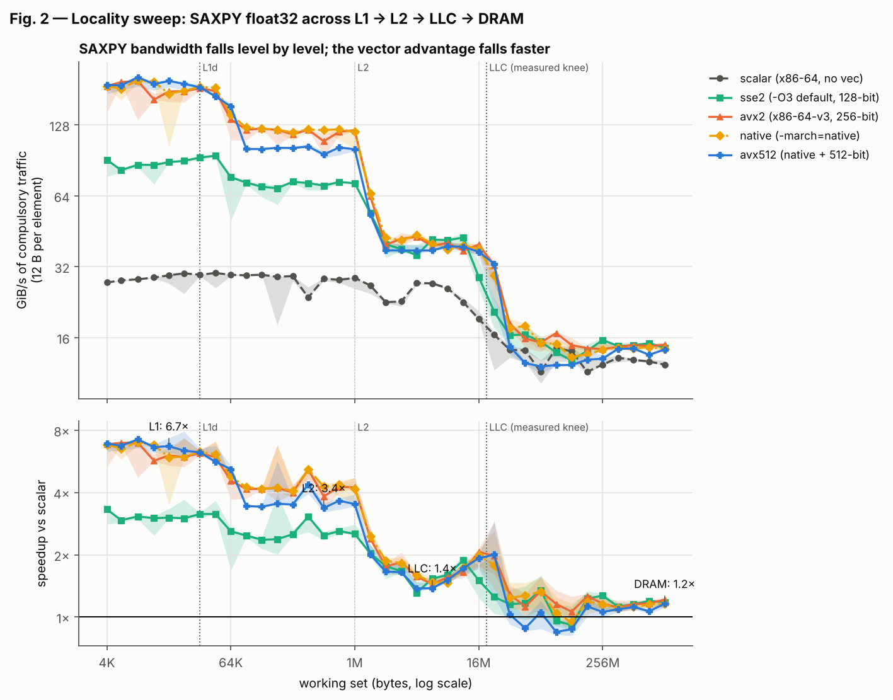

# SIMD Advantage Profiling (g++ · Windows/MSYS2 or Linux)

How much faster do simple numeric kernels get when **g++** auto-vectorizes them with SSE2, AVX2 or
AVX-512, and when does that advantage disappear? This repository measures scalar vs auto-vectorized builds
of SAXPY, dot product, element-wise multiply and a 3-point stencil on one core. It sweeps working-set size
(L1 → DRAM), data type, alignment, tail length and stride, verifies the vectorization from g++'s
optimization record and the disassembly, and interprets the results with a measured roofline.

It runs **natively on Windows 11 via MSYS2 (UCRT64 g++)**. The same scripts also run on Linux.

**→ Report: [`REPORT.md`](REPORT.md)** · Windows setup: **[`docs/WINDOWS.md`](docs/WINDOWS.md)** ·
Pre-registered predictions: [`docs/HYPOTHESIS.md`](docs/HYPOTHESIS.md) · Methods:
[`docs/METHODOLOGY.md`](docs/METHODOLOGY.md)



**Headline (reference run: Intel Xeon Cascade Lake, g++ 13.3, 1 core).** In L1, SAXPY runs **3.0×** (SSE2),
**6.0×** (AVX2) and only **6.7×** (AVX-512) faster than scalar: AVX-512 drops the clock by **20%**, as measured by a
built-in frequency-licence probe. The gain compresses to **3.8× in L2, 1.4× in LLC and 1.2× in DRAM**. g++ *reports*
the plain FP dot product as vectorized, yet it runs at **0.93–1.0×** (an in-order reduction). Shuffle-vectorized
strided loops run as slow as **0.34×** scalar. The first run's scalar baseline was 1.6× too slow purely because of
where the linker placed the loop; kernels are now built with pinned 64-byte code alignment (REPORT §11.1).

## Quick start

**Windows 11 (MSYS2 UCRT64 shell)**, full instructions in [`docs/WINDOWS.md`](docs/WINDOWS.md):

```bash
pacman -S --needed mingw-w64-ucrt-x86_64-gcc mingw-w64-ucrt-x86_64-python mingw-w64-ucrt-x86_64-python-numpy \
  mingw-w64-ucrt-x86_64-python-pandas mingw-w64-ucrt-x86_64-python-matplotlib mingw-w64-ucrt-x86_64-python-tabulate unzip git
bash scripts/run_all.sh --quick --tag smoke     # ~5 min end-to-end smoke test
bash scripts/run_all.sh --tag my-pc             # full run, ~45-60 min
```

**Linux**:

```bash
sudo apt install -y g++ python3-numpy python3-pandas python3-matplotlib python3-tabulate
bash scripts/run_all.sh --tag my-machine
```

Everything lands in `results/<tag>/`. `summary.md` has the key numbers and `figures/` the plots.

## Repository layout

```
src/
  kernels.cpp          code under test (compiled once per build variant, extern "C" names)
  kernels.hpp          declarations
  main.cpp             harness: timing, data init, reference checks, pinning, CLI   (fixed flags)
  manual.cpp           hand-written intrinsics: masked tails, peak-FLOP and clock probes (fixed flags)
  platform.hpp         Windows/Linux layer: QueryPerformanceCounter, _aligned_malloc, affinity, topology
scripts/
  build.sh             g++ builds of build/<variant>/bench(.exe): scalar, scalar_native, sse2, avx2, native, avx512
  test.sh              correctness: 12,168 checks (all variants x kernels x types x 26 sizes x 3 offsets)
  verify_vectorization.py  g++ optimization record (JSON) + disassembly evidence per function
  sysinfo.py           CPU, caches, cores/SMT/hybrid, power plan or governor, compiler, timer, pinning
  run_experiments.py   all experiments, pinned, 3 shuffled rounds, raw per-sample CSV
  probe_interference.py  diagnostic: address-layout effect vs temporal interference
  analyze.py           raw -> processed tables + summary.md
  plot.py              processed -> figures
  simdlib.py           shared helpers (bench.exe lookup, UTF-8 file I/O)
  run_all.sh           all of the above in order
docs/
  HYPOTHESIS.md        predictions, committed before the first measurement (+ g++ addendum, also before)
  METHODOLOGY.md       variants, timing, statistics, validation, roofline, Windows specifics
  WINDOWS.md           step-by-step for Windows 11 / MSYS2
results/cloud-vm-xeon-clx-gpp/   reference run used by REPORT.md
  sysinfo.json|txt     environment record
  raw/*.csv            every timing sample (+ commands.log with every command line)
  processed/*.csv      medians, IQR, GFLOP/s, GiB/s, cycles/element, speedups, roofs.json
  verification/        correctness.csv, vectorization_summary.md|csv, hot_loops.md, interference_probe.txt
  figures/*.png        all plots
  summary.md           auto-generated key numbers
results/cloud-vm-xeon-clx-gpp-run1-code-placement/   first g++ run, kept as evidence (REPORT §11.1)
REPORT.md              interpretation of the reference run
```

## How the assignment requirements map to this repo

| requirement | where |
|---|---|
| Reproducible repo: source, build, run, plotting scripts, raw + processed data, README | `src/`, `scripts/`, `results/<run>/raw` and `processed`, this file |
| Pre-experiment hypothesis | `docs/HYPOTHESIS.md`. Its commits predate the results they predict (`git log --reverse`) |
| Correctness validation | `scripts/test.sh` → `results/<run>/verification/correctness.csv` (methodology §5) |
| Measurement discipline | `results/<run>/sysinfo.json`, `run_meta.json`, `summary.md` header. Methodology §3 and §10. 3 independent rounds per configuration |
| Negative / failure case | REPORT §10, Fig. 7 |
| Honest anomalies | REPORT §11 |
| Scalar vs auto-vectorized, all kernels, all sizes | REPORT §3, Fig. 1a–c |
| Locality sweep across cache levels | REPORT §4, Fig. 2 |
| Alignment & tail handling | REPORT §5, Fig. 3a–b |
| Stride / gather | REPORT §6, Fig. 4 |
| Data-type comparison | REPORT §7, Fig. 5 |
| Vectorization verification | REPORT §8, `verification/vectorization_summary.md`, `hot_loops.md` |
| Roofline with measured bandwidth & peak | REPORT §9, Fig. 6 |
