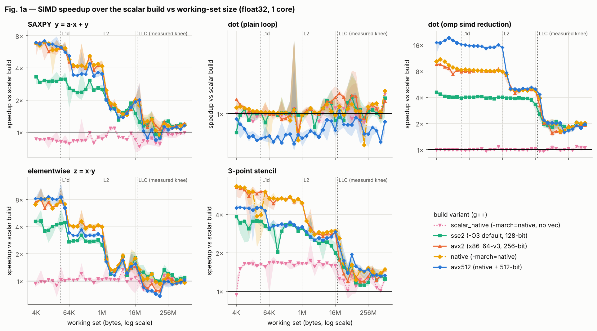
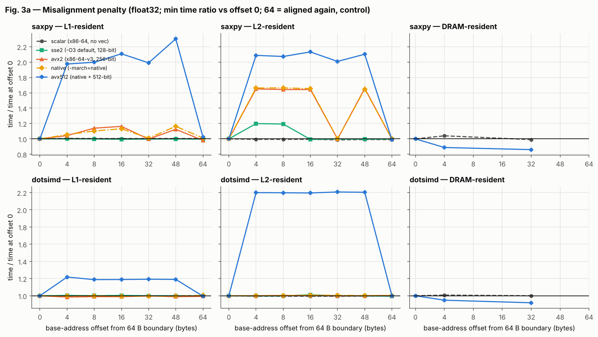
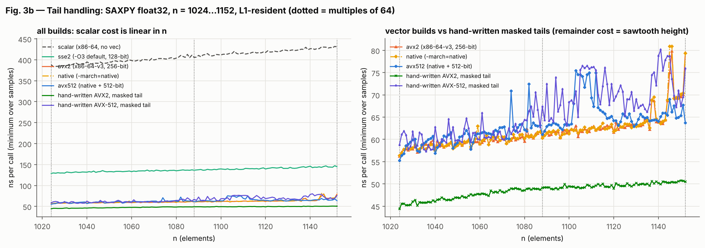
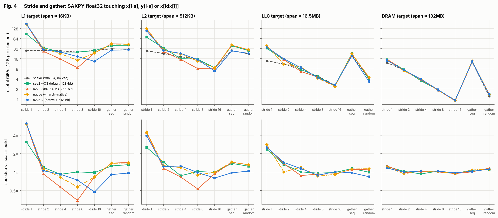
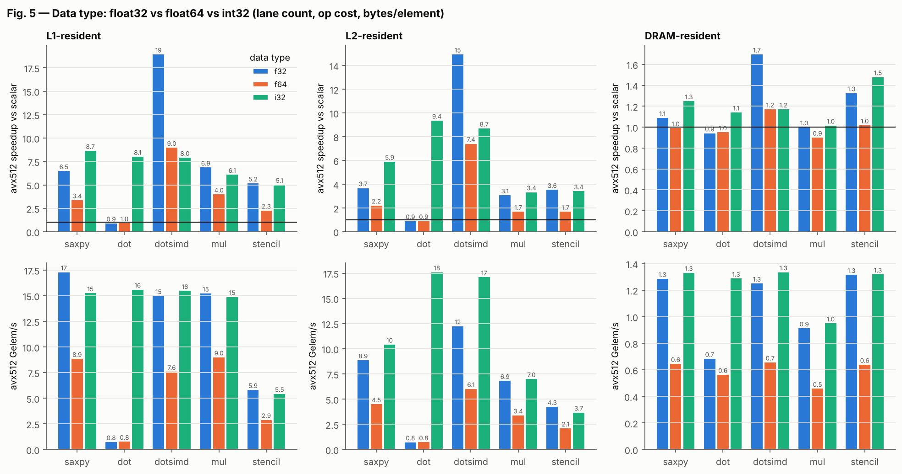
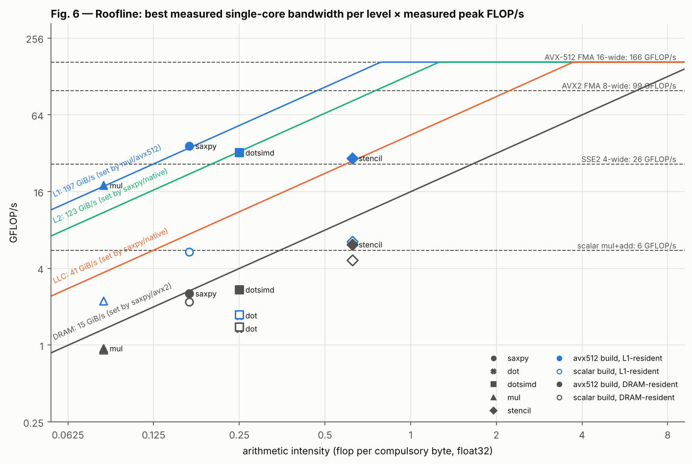
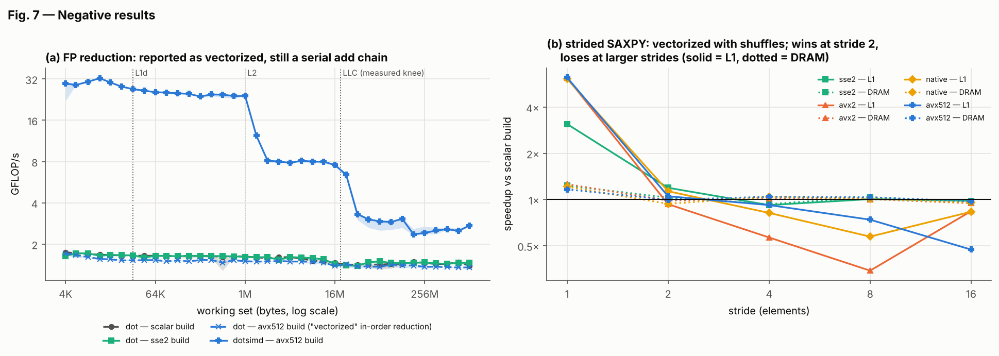

# SIMD Advantage Profiling (g++): Report

**Reference run:** `results/cloud-vm-xeon-clx-gpp/`. One vCPU of an Intel Xeon "Cascade Lake" core
(family 6 / model 85, AVX-512) in a KVM guest, measured with **g++ 13.3** at `-O3`. All experiments are
single-threaded and pinned. Every number below comes from `results/cloud-vm-xeon-clx-gpp/summary.md` or its
`processed/*.csv`. The project builds and runs natively on Windows 11 with MSYS2 UCRT64 g++
([`docs/WINDOWS.md`](docs/WINDOWS.md)). Those Windows binaries were cross-compiled with MinGW-w64 g++ and
validated under Wine: they pass all 12,168 correctness checks. **To produce your own results, run
`bash scripts/run_all.sh` on your PC.**

## 0. Summary

* **The vector speedup tracks lane count only at the narrow end, and only in L1.** SAXPY float32 in L1:
  **3.0×** with SSE2 (4 lanes), **6.0×** with AVX2 (8), but only **6.7×** with AVX-512 (16).
* **AVX-512 barely beats AVX2, for two measured reasons.** (1) The core clocks down **20%** (3.26 → 2.60 GHz)
  while running 512-bit FMAs (§11.2). (2) g++'s loops do one vector per iteration with no unrolling. For the
  stencil, AVX-512 is even *slower* than AVX2 (4.3× vs 6.1×).
* **The gain compresses level by level.** AVX2 SAXPY goes 6.0× (L1) → 3.8× (L2) → 1.4× (LLC) → 1.2× (DRAM).
  Beyond L1, every vector width hits the same bandwidth ceiling.
* **Negative results** (§10):
  1. g++ *reports* the plain FP dot product as "vectorized using 64 byte vectors", but it runs at
     **0.93–1.0×**: an in-order reduction whose 4-cycle add chain stays serial.
  2. Shuffle-vectorized strided loops run at **0.34×** (AVX2, stride 8).
  3. Memory-bound kernels gain 0.96–1.2× in DRAM even with 16 lanes.
* **Misalignment** costs AVX-512 **~2×** in L1 *and* L2, costs AVX2 1.65× in L2 except at 32-byte offsets,
  and costs nothing in DRAM.
* **The largest anomaly was a measurement artifact, and fixing it changed the conclusions** (§11.1). In the
  first g++ run, *where the linker happened to place* the scalar SAXPY loop made it 1.6× slower. That inflated
  every L1 speedup (AVX2 looked like 9.9×). All kernels are now built with `-falign-functions=64 -falign-loops=64`.

## 1. Setup (full details: [`docs/METHODOLOGY.md`](docs/METHODOLOGY.md), `sysinfo.json`)

| item | value |
|---|---|
| CPU | Intel Xeon @ 2.80 GHz nominal, family 6 / model 85 (Cascade Lake). Measured **3.26 GHz** normally, **2.60 GHz** right after AVX-512 work |
| ISA | SSE2…SSE4.2, AVX, AVX2, FMA, AVX-512 F/VL/BW/DQ/VNNI |
| caches | L1d 32 KiB, L2 1 MiB (per core), L3 33 MiB (shared). **Measured effective LLC knee ≈ 19 MiB** |
| OS / VM | Ubuntu 24.04.5 (kernel 6.18) in a KVM guest, 2 vCPUs, 8 GB RAM |
| frequency policy | not controllable in the guest (no cpufreq). Clock measured in every process and by the licence probe |
| SMT / pinning | guest sees 1 thread/core. Each process pins itself to CPU 1 (`sched_setaffinity`; on Windows `SetThreadAffinityMask` + HIGH priority) |
| compiler | g++ 13.3.0, `-std=c++17`, kernels `-O3` + variant flags + `-falign-functions=64 -falign-loops=64` |
| variants | `scalar`, `scalar_native` (FMA, no SIMD), `sse2`, `avx2` (x86-64-v3), `native`, `avx512` (`-mprefer-vector-width=512`) |
| timing | `CLOCK_MONOTONIC` (Windows: `QueryPerformanceCounter`), ≥ 10 ms per sample, **3 shuffled rounds × 7 samples** (DRAM 3 × 3) |
| statistics | median of round medians, IQR bands, conservative speedup intervals. Tail and alignment use the minimum |
| correctness | **12,168 checks, 0 failures** (Linux binaries, and again for the Windows binaries under Wine) |
| counters | none (no PMU in the VM). Evidence comes from g++'s optimization record plus disassembly |

## 2. Hypotheses vs outcomes

The original hypotheses (H1–H7) and the g++ addendum (G1–G6) were each committed before the measurements
they predict (`git log -- docs/HYPOTHESIS.md`).

| # | prediction | outcome |
|---|---|---|
| H1 | ≈ lane count in L1; 2–4× L2; 1.3–2× LLC; 1.0–1.2× DRAM | SSE2 ✔ (3.0×), AVX2 ✔ (6.0×), **AVX-512 ✘ (6.7×, see G3)**; L2 ✔ (3.4–4.3×); LLC ✔ (1.4–1.5×); DRAM ✔ (1.16–1.21×) |
| H2 / G1 | plain FP dot gains nothing; omp-simd version > lane count; int32 dot vectorizes without a pragma | ✔ 0.93–1.0×, though g++ *reports it vectorized* (§10.1); ✔ AVX-512 18.0× (AVX2 7.4×, just under 8); ✔ int32 8.1× |
| G1b | no FMA slowdown of the plain dot on this CPU (add and FMA latency are both 4 cycles) | ✔ `scalar_native` dot 0.97–1.06× |
| H3 | stencil keeps more speedup than SAXPY | ✔ L2 (5.0 vs 3.8×), LLC (2.7 vs 1.4×), DRAM (1.5 vs 1.2×); ≈ in L1 (6.1 vs 6.0×, AVX2) |
| H4 | f64 ≈ half the f32 L1 speedup; same GiB/s in DRAM; int32 gains less than f32 | ✔ f64 3.4× vs f32 6.5× (AVX-512 SAXPY); ✔ DRAM GiB/s equal; **int32 ✘ as a ratio (8.7× vs 6.5×), ✔ in absolute terms** (§7) |
| H5 / G6 | line-split pattern for misalignment, gone beyond L1; tail staircase; masks flatten it | ✔ pattern; ✘ **persists in L2** (AVX-512 2.0–2.2×); ✔ gone in DRAM; ✘ **no staircase with g++** (vectorized epilogue, ≤ 6 ns) |
| G2 | L1 SAXPY ≈ 4 / 7–8 / 10–14× | ✘ low: 3.0 / 6.0 / 6.7× (one vector per iteration, AVX-512 licence) |
| G3 | AVX-512 gains less over AVX2 than its width; `native` ≈ `avx2` | ✔ **strongly**: AVX-512 runs at 0.80× clock; `native` emits 256-bit code and tracks `avx2` |
| H6 / G4 | stride: no gain (0.8–1.2×), bandwidth ∝ 1/stride when memory-bound | ✔ 1/stride in DRAM; ✘ **worse than predicted**: L1 losses down to 0.34× |
| G5 | emulated gathers: ≤ 1.5× in L1, none in DRAM; random gather latency-bound | ✔ 1.39–1.43× (AVX2/native), AVX-512 0.91–0.97×; DRAM ≈ 1×; random 1.2–1.4 GiB/s vs 12.8 sequential |
| H7 | all kernels under the bandwidth roof, stencil perhaps near the compute roof in L1 | ✔, more strongly: the L1 ridge is 0.79 flop/B, so even the stencil (0.63) is left of it |

## 3. Scalar vs auto-vectorized across working-set sizes (Fig. 1a–c)



Speedup over the scalar build. WS = working set. The full table with IQR intervals is in `summary.md` §1.

| kernel (sse2 / avx2 / avx512) | L1 (16 KiB) | L2 (512 KiB) | LLC (5.7 MiB) | DRAM (1 GiB) |
|---|---|---|---|---|
| SAXPY | 3.0 / 6.0 / 6.7× | 2.5 / 3.8 / 3.4× | 1.5 / 1.4 / 1.4× | 1.18 / 1.21 / 1.16× |
| dot (plain) | 1.00 / 1.00 / **0.93×** | 1.01 / 1.02 / 0.91× | 1.02 / 1.02 / 0.95× | 1.05 / 1.04 / 0.97× |
| dotsimd | 4.0 / 7.4 / **18.0×** | 3.9 / 8.0 / 15.0× | 3.9 / 5.0 / 5.0× | 2.0 / 1.9 / 2.0× |
| mul | 4.0 / 6.5 / 8.2× | 2.7 / 3.8 / 3.2× | 1.9 / 1.9 / 1.7× | 1.10 / 1.03 / 1.03× |
| stencil | 3.5 / 6.1 / **4.3×** | 3.3 / 5.0 / 3.3× | 2.5 / 2.7 / 2.5× | 1.25 / 1.48 / 1.33× |

Cycles per element (Fig. 1c, measured clock), smallest L1 size:

* **Scalar SAXPY: 1.24 cycles/element.** Every access uses an indexed address (`(%rdx,%rax,4)`). On
  Skylake-family cores a store with an indexed address can't use the simple store-address port, so the 2 loads
  and 1 store compete for 2 address ports.
* **AVX2 / AVX-512 SAXPY: 0.19–0.20 cycles/element**, ~5 elements per nominal cycle. The disassembly shows
  why the two are close: g++'s main loop handles one vector per iteration with no unrolling
  (`vmovups; vfmadd213ps; vmovups; add; cmp; jne`). The AVX-512 loop also runs 20% slower clock (§11.2).
  The hand-unrolled AVX2 loop in `manual.cpp` is ~1.27× faster than g++'s at these L1 sizes (44 vs 56 ns, Fig. 3b).
* **Plain `dot`: 3.6–4.0 cycles/element in every build.** That is the 4-cycle FP-add latency of a serial chain (§10.1).
* **`dotsimd` with AVX-512: 0.22 cycles/element**, 17× faster than its own scalar build. Reassociation lets g++
  keep 16-lane partial sums, breaking the chain.
* `native` emits 256-bit code (g++'s tuning for this core prefers 256-bit vectors) and tracks `avx2` throughout.

## 4. Locality sweep: where the gain compresses (Fig. 2)


SAXPY float32, compulsory traffic (12 B/element):

| level | AVX2 GiB/s | scalar GiB/s | speedup | what limits the vector code |
|---|---|---|---|---|
| L1 (≤ 32 KiB) | ~183 | ~28.5 | 6.0× | issue/AGU throughput of a non-unrolled loop (§3), not L1 bandwidth |
| L2 (≤ 1 MiB) | ~122 | ~29 | 3.8× | L2→L1 fill bandwidth (this kernel sets the measured L2 roof, 123 GiB/s) |
| LLC (≤ ~19 MiB) | ~41 | ~27 | 1.4× | per-core mesh/LLC bandwidth |
| DRAM | ~15 | ~12.8 | 1.2× | single-core DRAM bandwidth (outstanding misses) |

Wider vectors stop paying off as soon as the data leaves L1. In L2, AVX-512 (3.4×) is *below* AVX2 (3.8×):
same bandwidth ceiling, lower clock. The scalar build is nearly flat from L1 to LLC (29 → 27 GiB/s), because
it is limited by instruction throughput, not memory. Hence the vector advantage "compresses" not because
vectors get slower, but because the ceiling drops to meet the scalar code.

## 5. Alignment and tail handling (Fig. 3a, 3b)



Both arrays are shifted by the same byte offset from a 64 B boundary. Minimum time relative to offset 0:

| build | SAXPY L1 (offsets 4–48) | SAXPY L2 (4/8/16/48 · 32) | dotsimd L2 (loads only) | DRAM |
|---|---|---|---|---|
| scalar | 1.00–1.01 | 0.99 | 0.99–1.00 | 0.99–1.04 |
| sse2 (16 B) | 0.99–1.00 | 1.20 at 4/8, **1.00 at 16, 32, 48** | 1.00 | — |
| avx2 / native (32 B) | 1.01–1.16 | **1.64–1.66 · 1.00 at 32** | 1.00 | — |
| avx512 (64 B) | **1.97–2.30** | **2.01–2.13 at every offset** | **2.20** | 0.86–0.95 |

A penalty appears exactly when a vector access can straddle two cache lines, i.e. when the offset isn't a
multiple of the vector width. The pattern is clearest in L2: AVX2 pays 1.65× at offsets 4/8/16/48 and nothing
at 32; SSE2 pays only at 4 and 8. AVX-512 pays ~2× at *every* misaligned offset, because every 64 B access then
spans two lines. Two details went against my hypothesis. (1) The penalty **does not vanish in L2**: each split
access needs two lines filled from L2, so the L2→L1 bandwidth bound is halved. (2) **256-bit loads that split
in L1 cost almost nothing** (dotsimd AVX2 1.00×); the cost appears with stores (SAXPY) and in L2. g++ doesn't
peel the loop for alignment here (its report: "Unknown misalignment, naturally aligned"), so the misaligned
accesses are really executed.



**Tail handling.** n = 1024…1152, L1-resident, minimum ns per call. Unlike a compiler that unrolls ×4 and leaves a
scalar remainder of up to 31 elements (the Clang pilot showed a clear 32/64-element staircase), g++ emits **a
vectorized epilogue** (the "+16B epilogue" entries in the optimization record) and no unrolling. The remainder
is therefore at most a few elements. AVX2 costs only **≤ 6.2 ns** (+11%) over n = 1024 anywhere in the range, with a
small period-8 ripple. The hand-written masked AVX2 kernel is flatter (≤ 4.6 ns) **and 1.27× faster overall** (44 vs
56 ns at n = 1024), because it unrolls ×4. The AVX-512 curves (g++ and hand-written masked) are higher and
jumpier (up to +17 ns). That is consistent with the frequency licence switching on and off in these short,
repeated calls (§11.2).

## 6. Stride and gather (Fig. 4)



* **Useful bandwidth falls as 1/stride once memory-bound.** DRAM, scalar: 12.2 → 7.3 → 3.7 → 1.8 → 0.9 GiB/s for
  s = 1, 2, 4, 8, 16. Each doubling halves the useful bytes per 64 B line.
* **SIMD efficiency collapses, and turns negative in cache.** g++ vectorizes every strided loop with loads plus
  permutes and lane-by-lane stores. In L1 that gives 0.93–1.19× at stride 2, but **0.57× (AVX2, s4), 0.34× (AVX2, s8)
  and 0.47× (AVX-512, s16)**. The shuffle and extract work costs more than the scalar loop it replaces. In DRAM every
  build is within 0.93–1.04× of scalar: memory traffic is identical whatever the instruction mix.
* **Gather through an index array:** g++'s tuning for this core avoids `vgatherdps` and emulates gathers with
  scalar loads and inserts. That gives 1.39–1.43× (AVX2/native) in L1, but 0.91–0.97× with AVX-512. A **random** gather
  from DRAM is latency-bound at 1.2–1.4 GiB/s, 10× below a sequential gather, and SIMD doesn't change it.

## 7. Data types (Fig. 5)



AVX-512 build vs scalar (data-type experiment):

| kernel | f32 L1 / L2 / DRAM | f64 L1 / L2 / DRAM | i32 L1 / L2 / DRAM |
|---|---|---|---|
| SAXPY | 6.5 / 3.7 / 1.09× | 3.4 / 2.2 / 0.99× | 8.7 / 5.9 / 1.25× |
| dot (plain) | 0.94 / 0.94 / 0.95× | 0.96 / 0.94 / 0.96× | **8.1 / 9.4 / 1.15×** |
| dotsimd | 19.0 / 15.0 / 1.70× | 9.0 / 7.4 / 1.17× | 8.0 / 8.7 / 1.17× |
| mul | 6.9 / 3.1 / 1.00× | 4.0 / 1.7 / 0.90× | 6.1 / 3.4 / 1.02× |
| stencil | 5.2 / 3.6 / 1.33× | 2.3 / 1.7 / 1.02× | 5.1 / 3.4 / 1.48× |

* **Lane count:** f64 has half the lanes and gets about half the f32 speedup in L1 (SAXPY 3.4 vs 6.5×,
  dotsimd 9.0 vs 19.0×).
* **Bytes per element:** in DRAM, f64 moves the same GiB/s as f32. Elements/s halve (scalar SAXPY: 0.65 vs
  1.18 Gelem/s), and the SIMD gain is ~1.0×.
* **Operation cost:** the int32 *ratio* is larger than f32's (8.7 vs 6.5×), against my hypothesis, but only because
  the scalar int32 SAXPY baseline is slower (1.76 vs 2.66 Gelem/s: `imul` + `add` through memory). In absolute
  terms the AVX-512 int32 loop is ~12% slower than the f32 one (15.3 vs 17.4 Gelem/s), which is the `vpmulld`
  (2 µops) cost the hypothesis predicted.
* **Associativity:** integer addition is associative, so the plain int32 `dot` vectorizes properly (8.1×).
  The FP one can't without permission (`dotsimd`).

## 8. Vectorization verification

Full tables: `verification/vectorization_summary.md` (23 functions × 6 variants: g++ optimization-record verdict
next to the disassembly verdict) and `verification/hot_loops.md` (inner-loop excerpts).

| function | `scalar` | `avx2` | `avx512` |
|---|---|---|---|
| `saxpy_f32` | scalar (vectorizer off) | 32 B main + 16 B epilogue → **ymm** | 64 B main + 32 B epilogue → **zmm** |
| `dot_f32` | scalar | "vectorized 32B" → **vmulps ymm + 8 serial `vaddss`** | "vectorized 64B" → **vmulps zmm + 16 serial `vaddss`** |
| `dotsimd_f32` | scalar | ymm, parallel partial sums | zmm, parallel partial sums |
| `dot_i32` | scalar | ymm `vpmulld`/`vpaddd` | zmm |
| `saxpy_s4_f32` | scalar | ymm + shuffles | zmm + shuffles |
| `saxpy_gather_f32` | scalar | ymm, gather emulated with inserts | zmm, gather emulated |

```asm
; saxpy_f32, avx512 build: one 16-float vector per iteration (no unrolling)
vmovups      (%r8,%rax,1),%zmm0
vfmadd213ps  (%r9,%rax,1),%zmm2,%zmm0
vmovups      %zmm0,(%r9,%rax,1)
add $0x40,%rax ; cmp %rcx,%rax ; jne

; dot_f32, avx512 build: "loop vectorized using 64 byte vectors", but the adds stay in order
vmulps (%rdx,%rax,1),%zmm5,%zmm1          ; 16 products in parallel ...
vaddss %xmm1,%xmm0,%xmm0                  ; ... then 16 dependent scalar adds
vshufps $0x55,%xmm1,%xmm1,%xmm4 ; vaddss %xmm4,%xmm0,%xmm0 ; ...   (x16)

; saxpy_f32, scalar build (x86-64 baseline)
movss (%rsi,%rax,4),%xmm1 ; mulss %xmm0,%xmm1 ; addss (%rdx,%rax,4),%xmm1 ; movss %xmm1,(%rdx,%rax,4)
```

## 9. Roofline (Fig. 6)



* **Compute roofs (measured, f32):** scalar mul+add 5.5, SSE2 26.3, AVX2 FMA 98.9, AVX-512 FMA **165.8 GFLOP/s**.
  At the nominal 3.26 GHz the AVX-512 figure is 51 flop/cycle. At the **2.60 GHz it actually runs at** it is 64:
  exactly two 512-bit FMA pipes × 16 lanes × 2.
* **Memory roofs** (best sustained by any streaming kernel in any vector build): L1 197 (mul/AVX-512),
  L2 123, LLC 41, DRAM **14.9 GiB/s** (SAXPY/native and avx2). The AVX-512 build alone would give lower L2/LLC roofs,
  because of its reduced clock. The read-only probe reaches only 61 GiB/s in L1, because g++ doesn't interleave
  its `omp simd` reduction, so it is bound by add latency.
* **Ridge points (AVX-512 peak):** 0.79 flop/B (L1), 1.3 (L2), 3.7 (LLC), **10.4 (DRAM)**. Every kernel here has
  AI ≤ 0.63 flop/B. So **every kernel is bandwidth-bound at every level**, including the stencil in L1. In DRAM,
  SAXPY would need ~60× more arithmetic per byte before 16-lane FMAs mattered.
* The vector builds sit on or near the L1/L2 roofs for SAXPY and mul (they define them). **The stencil sits far
  below its L1 roof** (AVX2 39 GFLOP/s against 132 available). Its 3 loads per output, two of them always off the
  vector grid, and its mul+FMA chain limit it in-core.
* **The scalar build sits under its own roof** (5.3 GFLOP/s SAXPY in L1 against a 5.5 GFLOP/s scalar mul+add peak
  and a 35 GFLOP/s bandwidth roof). The scalar code is instruction-bound. SIMD lifts that ceiling until a memory
  roof binds, and that is the whole story of Fig. 2.

## 10. Negative results (Fig. 7)



**10.1 Reported as vectorized, but no faster.** For `s += x[i]*y[i]` on floats, g++'s optimization record says
"loop vectorized using 64 byte vectors" (AVX-512) or "32 byte vectors" (AVX2). A report-only check would call it
a success. The disassembly shows an **in-order ("fold-left") reduction**: one `vmulps` computes 16 products,
then 16 *dependent* `vaddss` add them to the running sum one at a time, preserving IEEE summation order. The
dependency chain is unchanged: 3.6–4.0 cycles per element in every build, the FP-add latency. Measured speedup:
1.00× (SSE2/AVX2) and **0.91–0.97× (AVX-512)**, slightly *slower* because of the extra shuffles and the
licence. Allowing reassociation (`#pragma omp simd reduction(+:s)`) gives **18×**.

**10.2 Vectorized and slower: strided access.** g++ vectorizes the stride-4/8/16 SAXPY with permutes and
lane-wise stores. In L1 that runs at **0.34–0.82×** of scalar for AVX2/native (s4–s8), and **0.47×** for
AVX-512 at s16. The cost model approved the transformation, and the hardware disagreed.

**10.3 Vectorized and memory-bound.** In DRAM, AVX-512 SAXPY is 1.16× and mul is 1.03× against the scalar
build, with 16 lanes. The DRAM ridge (10.4 flop/B) is 60–125× above these kernels' arithmetic intensity.

**10.4 Wider is slower.** The AVX-512 stencil (4.3× in L1, 3.3× in L2) loses to AVX2 (6.1×, 5.0×). AVX-512 runs at
a 20% lower clock (§11.2), and every one of its misaligned neighbour loads (`x[i±1]`) splits a cache line.

## 11. Anomalies and their most plausible explanations

**11.1 Code placement changed a kernel's speed by 1.6×, and the first g++ run was wrong because of it.**
The first full g++ run (`results/cloud-vm-xeon-clx-gpp-run1-code-placement/`) measured scalar SAXPY at ~2.0
cycles/element. After I rebuilt the harness (adding the licence probe, with `kernels.cpp` untouched), the same
measurement gave ~1.24. I rebuilt the *exact* run-1 binaries from git and compared (`verification/code_placement_test.txt`
in run 1). The machine code of `saxpy_f32` is byte-identical, but the linker had placed it 32 bytes earlier
(0x66a0 vs 0x66c0). That puts its 28-byte loop across a 64-byte boundary, and it ran at **1260 vs 775 ns**. The
`jne` doesn't end on a 32-byte boundary in either layout, so it isn't the textbook JCC-erratum case. The most
plausible cause is a front-end effect (µop cache / decode) on this Skylake-derived core. Without a PMU I can't
confirm it. **Impact:** run 1's slow scalar baseline inflated every L1/L2 speedup. It reported SAXPY at 5.1×
(SSE2), 9.9× (AVX2) and 10.4× (AVX-512), which looked like a neat confirmation of the lane-count hypothesis.
**Fix:** kernels are now compiled with `-falign-functions=64 -falign-loops=64`. With that, the same kernel runs at
764–792 ns whichever harness it is linked with, and the reference run uses those binaries. Lesson: a speedup is
only as trustworthy as its baseline, and the baseline can depend on things outside the loop being measured.

**11.2 The AVX-512 frequency licence.** `bench --license` runs ~30 ms of each kind of work, then immediately times a
dependent-add chain. Measured clock: 3.26 GHz after scalar, SSE2 or AVX2 FMA work, but **2.60 GHz after AVX-512
FMA work (0.80×)**, recovering within milliseconds (idle again: 3.28). This one effect explains several results.
AVX-512 SAXPY is only 6.7× against AVX2's 6.0× in L1. AVX-512 loses to AVX2 for the stencil and in L2. The
hand-written AVX-512 masked kernel is slower than the AVX2 one. And the AVX-512 peak is 51 flop per *nominal*
cycle but exactly 64 per *actual* cycle. The per-process clock estimate is taken before any vector work, so on
its own it would have missed this. AMD Zen 4/5 and recent Intel cores have much smaller or no such penalties.

**11.3 Interference bursts on a shared host.** Within a single process, samples swing from 24 µs to 58 µs and back
(the same command run in two experiments: clean in one, hit in all three rounds in the other). `probe_interference.py`
found slow runs scattered across address layouts (0–2 of 14 per layout) while addresses were identical. Overall,
7.5% of configurations had one round > 1.5× off the others. The 3-round median outvotes a single bad round. For
the deterministic micro-effects (alignment, tails) the analysis uses the **minimum**, after one alignment point
(scalar SAXPY in L2, offset 0) was hit in all three rounds.

**11.4 4K aliasing is real and large here.** The same probe also shifts `y` relative to `x`. With `y` 4 bytes past
`x` modulo 4096, a load of `x[i+1]` has the same address bits 0–11 as the pending store to `y[i]`, and the CPU
treats it as a possible dependency. That layout was slow in **14 of 14 runs: 1739 vs ~1060 ns (1.6×)**. A 64-byte
shift was also slower (1476 ns), and a 2048-byte shift was not. The main experiments never hit this, because all
arrays share the same 4 KiB alignment.

**11.5 The LLC is smaller than reported.** sysfs reports 33 MiB of L3. The read stream falls to DRAM speed at
**~19 MiB** (knee detected automatically). This is a VM sharing a non-inclusive L3 with other tenants. The analysis
uses the measured size.

**11.6 Smaller oddities.**
* The `scalar_native` SAXPY (scalar FMA with a memory operand) is 0.85× of the plain scalar build in L1, in an
  aligned 6-instruction loop. My best guess is scheduling of the unlaminated indexed-address µops; unconfirmed
  without counters.
* Misaligned AVX-512 SAXPY/dotsimd are ~10% *faster* than aligned ones in DRAM (0.86–0.95). That's small, possibly a
  prefetcher/page-boundary interaction, and not investigated further.
* The `native` dotsimd L1 alignment point at offset 0 was slow in 2 of 3 rounds in the median-based data. The minimum-based
  ratio is clean (1.00).

## 12. Threats to validity

* **Not your machine.** One microarchitecture (Cascade Lake), in a VM on shared hardware, with no frequency control
  and no PMU. Your Windows PC will differ, especially on AMD: Zen 4 runs AVX-512 on 256-bit datapaths and has
  no frequency licence, Zen 5 desktop has full 512-bit datapaths, and Zen 2/3 have no AVX-512 at all. Re-run
  everything on your own machine.
* **One compiler, one version** (g++ 13.3). The Clang pilot, on a different host and kept in git history, made
  different choices: it unrolled ×4, used hardware gather/scatter for strides, and left a scalar remainder.
* Bytes are compulsory bytes (no write-allocate). Single-thread DRAM bandwidth is far below socket bandwidth by design.
* The 3-round median and the minimum statistic mitigate interference. They don't eliminate it for DRAM-bound points.

## 13. Reproduce

```bash
bash scripts/run_all.sh --tag my-pc                    # Windows: in the MSYS2 UCRT64 shell (docs/WINDOWS.md)
python scripts/probe_interference.py --out probe.txt   # address-vs-time diagnostic (§11.3, §11.4)
build/native/bench --cpu 1 --license                   # frequency-licence probe (§11.2)
```
